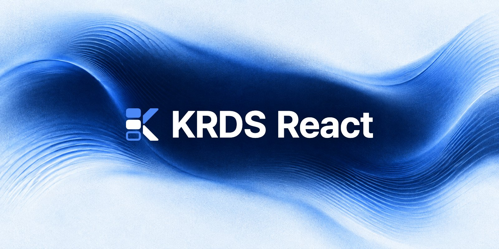

<p align="center">
  <a href="https://react.krds.initializer.org/">
    
  </a>
</p>

<div align="center">

[](https://www.npmjs.com/package/@krds.ui/react)
[](https://www.npmjs.com/package/@krds.ui/react)
[](https://github.com/Initializer-org/krds-react/actions/workflows/ci.yml)
[](https://www.npmjs.com/package/@krds.ui/react)
[](https://react.dev/)
[](https://www.npmjs.com/package/krds-react)
[](./LICENSE)

</div>

<hr />
<div align="center">

<a href="https://react.krds.initializer.org/">문서</a>
<span>&nbsp;&nbsp;•&nbsp;&nbsp;</span>
<a href="https://react.krds.initializer.org/guide/getting-started">시작하기</a>
<span>&nbsp;&nbsp;•&nbsp;&nbsp;</span>
<a href="https://react.krds.initializer.org/components/">컴포넌트</a>
<span>&nbsp;&nbsp;•&nbsp;&nbsp;</span>
<a href="https://react.krds.initializer.org/playground">플레이그라운드</a>
<span>&nbsp;&nbsp;•&nbsp;&nbsp;</span>
<a href="https://www.npmjs.com/package/@krds.ui/react">npm: @krds.ui/react</a>
<span>&nbsp;&nbsp;•&nbsp;&nbsp;</span>
<a href="https://www.npmjs.com/package/krds-react">공식 krds-react</a>
<span>&nbsp;&nbsp;•&nbsp;&nbsp;</span>
<a href="https://krds.initializer.org/">KRDS Vue</a>

</div>
<hr />

## KRDS React: 대한민국 정부 디자인 시스템을 React로

**KRDS React의 npm 패키지는 [`@krds.ui/react`](https://www.npmjs.com/package/@krds.ui/react)입니다.** [Initializer Team](https://github.com/Initializer-org)이 유지보수하는 커뮤니티 라이브러리이며, 정부가 배포하는 공식 패키지와 별도로 배포됩니다.

[KRDS(대한민국 정부 디자인 시스템)](https://www.krds.go.kr/html/site/index.html)의 공식 디자인을 유지하면서, 실제 서비스에서 겪는 접근성 오류와 React 호환성 문제를 고친 컴포넌트 라이브러리입니다. 공식 [`krds-react@1.1.1`](https://www.npmjs.com/package/krds-react)(ISC)을 포팅했으며, 기존 컴포넌트·props·CSS를 기반으로 사용할 수 있습니다.

- **접근성 오류 수정.** 레이블 연결, 화면낭독기에 전달되는 이름과 설명, 서버 렌더링 ID 문제를 고쳤습니다. 문서 예제와 회귀 테스트로 수정 사항을 검사합니다.
- **React 18·19 동작 검증.** 원본 Modal의 React 18 경고와 정리 누락을 수정했습니다. 모달을 닫거나 화면에서 제거했을 때 포커스와 스크롤이 복원되는지 두 버전에서 확인합니다.
- **Next.js·TypeScript 연결 보완.** Next.js App Router용 `"use client"`, CSS import 타입 선언, 누락된 하위 컴포넌트와 props 타입 export를 제공합니다.

## 공식 패키지에서 개선한 점

공식 `krds-react@1.1.1`을 기준으로 직접 수정하고 검증한 내용입니다.

| 사용 중 겪을 수 있는 문제                                              | @krds.ui/react의 개선                                                                                             |
| ---------------------------------------------------------------------- | ----------------------------------------------------------------------------------------------------------------- |
| 레이블이 입력 요소와 연결되지 않거나 화면낭독기에 잘못된 이름이 전달됨 | 체크박스·셀렉트의 자동 ID와 레이블 연결, 모달 제목, 툴팁 설명을 수정했습니다.                                     |
| React 18에서 Modal 경고가 발생하고 정리 작업이 누락됨                  | 닫기·화면 전환 시 observer와 타이머를 해제하고 포커스·배경 스크롤을 복원합니다. React 18.2와 19에서 검증했습니다. |
| 서버 렌더링과 브라우저의 라디오 ID가 달라짐                            | 임의의 숫자 대신 `useId`를 사용해 서버·브라우저 ID를 맞췄습니다.                                                  |
| 구현된 하위 컴포넌트와 타입을 패키지에서 가져올 수 없음                | `TagWrap`, HelpPanel 하위 컴포넌트, `SelectOption`, `StepItem` 등 누락된 export를 보완했습니다.                   |

Next.js App Router에서 불러올 수 있도록 빌드에 `"use client"`를 선언하고, TypeScript의 CSS import 검사에 필요한 타입 선언도 제공합니다. 문서 예제의 axe-core 검사와 회귀 테스트를 CI에서 실행해 수정한 동작을 계속 확인합니다.

수정한 코드와 원본과의 차이는 [포팅 기록](./PORTING.md)에 정리했습니다.

## 빠른 시작

```bash
npm install @krds.ui/react
```

pnpm을 쓰면 `pnpm add @krds.ui/react`로 설치합니다. `Initializer-org/krds-react`는 GitHub 저장소 이름이며, 설치와 import에는 `@krds.ui/react`를 사용합니다. [패키지 이름과 원본과의 관계](https://react.krds.initializer.org/guide/faq#package-names)를 참고하세요.

```tsx
import { Button, TextInput } from '@krds.ui/react'
import '@krds.ui/react/style'

export default function Page() {
  return (
    <>
      <TextInput label="신청인 이름" />
      <Button variant="primary">신청하기</Button>
    </>
  )
}
```

React `>=18.2.0`과 ESM을 지원하는 번들러가 필요합니다(CommonJS `require()`는 지원하지 않음). 개별 import, Next.js App Router, 스타일, 글꼴 설정은 [시작하기](https://react.krds.initializer.org/guide/getting-started)를 참고하세요.

위 설정을 담은 Vite 예제가 [`examples/vite`](./examples/vite)에 있습니다.

[](https://stackblitz.com/github/Initializer-org/krds-react/tree/main/examples/vite)

## 접근성

라이브러리 차원의 자동 검사는 서비스 전체의 접근성 평가를 대체하지 않습니다. 사용처의 콘텐츠와 화면 구성에 맞춰 별도로 검증해야 합니다.

## 기준 버전과 호환성

공식 `krds-react@1.1.1`(ISC)을 기준으로 합니다. 원본과의 차이와 남아 있는 제약은 [포팅 기록](./PORTING.md)에 있습니다.

`0.1.1`에서 React 18의 Modal 정리 문제와 누락된 컴포넌트·타입 export를 수정했습니다. 변경 내역은 [릴리스](https://github.com/Initializer-org/krds-react/releases)를 참고하세요.

## 기여하기

**버그와 기능 요청**은 [이슈](https://github.com/Initializer-org/krds-react/issues)로 남겨 주세요.

개발 환경과 빌드·테스트 방법은 [CONTRIBUTING](./.github/CONTRIBUTING.md)에 있습니다.

## 라이선스

ISC © [Initializer Team](https://github.com/Initializer-org). 원본 krds-react의 저작권 표시를 [LICENSE](./LICENSE)에 함께 남깁니다.
